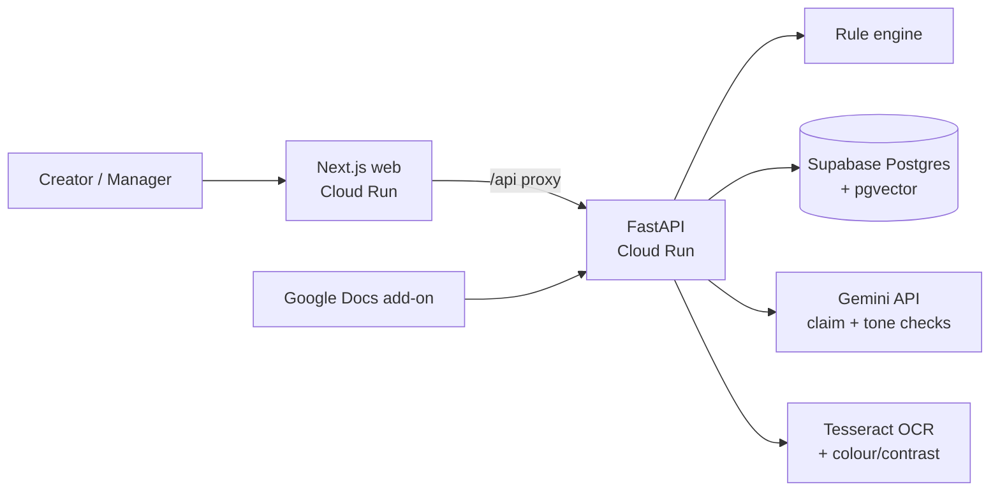

# BrandPilot

**Catch off-brand content before the world sees it.**

BrandPilot is a brand-governance platform built by **Team Furious** for CodeTitans India 2026
(problem statement by Inkloom AI). A brand team stores its voice guide, approved facts and rules
once. Creators paste a post or upload a design. BrandPilot marks every problem, says **why**, cites the
**exact rule or fact**, and suggests the smallest fix. A manager approves before anything is published.

> AI suggests. Humans decide. No source, no flag.

## What works today

| Step | What happens |
|---|---|
| 1. Brand vault | Voice guide, 15 approved facts and 18 rules for the sample brand *NutriCrunch* (fictional). Managers can add or delete facts and rules. |
| 2. Write & check | Paste text **or upload an image**, pick a channel, get a marked-up proof with numbered, colour-coded underlines. |
| 3. Explain & fix | Each issue card shows the type, risk level, reason, source code (e.g. `R-4.5`, `F-07`) and a before → after fix. |
| 4. Decide | **Accept fix**, **Edit**, or **Ignore** (a reason is required). Every change saves a new version. |
| 5. Submit | Blocked until all normal issues are resolved. High-risk claims go to the reviewer. |
| 6. Review | The manager must decide every remaining flag, then **Approve** or **Send back** with a comment. |
| 7. Google Docs | An add-on checks text inside Google Docs, highlights problems and applies fixes there (see `docs-addon/`). |
| 8. Insights | **Guideline Gap Radar**: rules creators override at least half the time, with their reasons, so the brand team can fix unclear guidelines. |

### Three layers of checks

1. **Brand rules** (always on, exact): banned words, correct terms, tone patterns, claim policy, accessibility.
2. **AI checks** (on when `GEMINI_API_KEY` is set):
   - **Claims vs approved facts.** Gemini lists the factual claims, each claim is matched to the 3 closest
     approved facts with pgvector, and Gemini judges it using *only* those facts. A contradiction must cite
     one of those fact codes or it is thrown away. Every AI claim flag goes to a human reviewer.
   - **Tone vs voice guide.** Gemini must quote the exact guideline it relies on. If that line isn't in the
     guide, the flag is thrown away.
   - Emails and phone numbers are masked before any text is sent to the AI.
   - If the AI is down, the scan still saves the rule findings and the page says AI checks didn't run.
3. **Image checks** (for uploaded PNG, JPEG or WebP designs):
   - **Text in the image** is read with Tesseract OCR (twice: once normally, once with a mask that makes faint
     text dark) and then goes through the brand rules and AI checks like typed text.
   - **Text contrast** of every line is measured against WCAG 1.4.3 (4.5:1, or 3:1 for large text).
   - **Brand colours**: strong colours covering at least 8% of the image must be close to a brand colour.

## Architecture



- **web/** – Next.js 15 (App Router, TypeScript, Tailwind CSS 4). The browser only talks to `/api/*`,
  which the Next server forwards to the API using the runtime `API_URL`. One image works everywhere and needs no CORS.
- **api/** – FastAPI + psycopg 3. All SQL is in `app/repo.py`; rule checks in `app/rules_engine.py`;
  AI checks in `app/ai.py` (Gemini client in `app/gemini.py`); image checks in `app/vision.py`;
  personal data masking in `app/privacy.py`.
- **docs-addon/** – Google Apps Script add-on for Google Docs (early version).
- **api/sql/schema.sql** – tables for brands, facts (with `vector(768)` embeddings), rules, scans,
  versions, issues and reviews, plus `match_facts()` for fact search.

### How a check works

1. Every rule is compiled (whole-word, case-insensitive for words and terms; regex for tone, claims and accessibility).
2. Each match becomes an issue with its exact character span, the rule's message and the rule code as its source.
3. Claim-policy and high-risk issues are marked **needs human**: they never block the creator, but a reviewer must decide them.
4. Accepting or editing a fix rewrites only that span, saves a version and re-aligns the other open issues.

## Run it locally

Needs Python 3.11+, Node 22, Tesseract OCR (`sudo apt install tesseract-ocr`, or `brew install tesseract`)
and a Postgres database with pgvector (a free Supabase project works).

```bash
# 1. Database
psql "$DATABASE_URL" -f api/sql/schema.sql

# 2. API
cd api
python -m venv .venv && source .venv/bin/activate     # Windows: .venv\Scripts\activate
pip install -r requirements-dev.txt
export DATABASE_URL="postgresql://..."                 # Windows PowerShell: $env:DATABASE_URL="..."
python -m seed.seed --demo                             # sample brand + 2 demo drafts
uvicorn app.main:app --reload --port 8080

# 3. Web (new terminal)
cd web
npm install
API_URL=http://localhost:8080 npm run dev             # open http://localhost:3000
```

Use **Viewing as** in the top bar to switch between Creator and Manager.

## Deploy

[](https://vercel.com/new/clone?repository-url=https%3A%2F%2Fgithub.com%2Frahulganesh-tech%2Fbrandpilot%2Ftree%2Fmain%2Fweb&project-name=brandpilot-web&env=API_URL&envDescription=FastAPI%20backend%20URL%20(e.g.%20https%3A%2F%2Fbrandpilot-api-...run.app))

See [DEPLOY.md](DEPLOY.md) for full deployment steps (Supabase database, FastAPI on Google Cloud Run, and Next.js web on Vercel or Cloud Run).


## Accuracy

`api/tests/test_set.json` holds 30 hand-labelled NutriCrunch posts (rule breaks, wrong numbers,
old prices, unsafe health claims, clean posts, and a post with an email address). Run:

```bash
cd api
python eval.py          # brand rules
python eval.py --ai     # + AI claim checker (needs GEMINI_API_KEY)
```

Brand rules today: **22 of 22 expected flags found, 0 false alarms (100% precision, 100% recall)**.
The first run found one false alarm (our brand name inside `hello@nutricrunch.in`), which we fixed by
skipping matches inside emails and links. The AI checker has 11 labelled contradictions to find; run
`python eval.py --ai` with your key to get its score.

## Tests

```bash
cd api
pytest -q                                                    # rule engine + privacy tests
TEST_DATABASE_URL=postgresql://... pytest -q                 # + full API workflow tests
```

48 tests cover the rule engine, the labelled test set, PII masking, the Gemini client (with mocked HTTP),
the AI guardrails with a scripted fake model (made-up fact codes, quotes not in the text, invented
guidelines, outages), fact search through real pgvector, image checks (OCR, faint text, WCAG contrast,
brand colours), image upload, and the full create → fix → submit → review → approve workflow.
GitHub Actions runs them on every push.

## Roadmap

- Sign-in with real roles (today a "Viewing as" switch stands in for creator and manager accounts, so judges
  can try both sides without accounts).
- Logo checks in images, and AI reading of text that OCR misses.
- Google Docs add-on: pick the brand, and publish it to the Google Workspace Marketplace.
- User testing with real creators and brand managers.

## Team Furious

| Name | Role |
|---|---|
| Rahulganesh S K | Team lead · AI & backend |
| Sane Lakshmidhar Reddy | Frontend · vision & QA |

Dr. M.G.R. Educational and Research Institute

## Disclosure

Built with AI assistance (Claude by Anthropic and Google Antigravity) for code generation and review.
The team reviewed, tested and is responsible for all code. External services: Supabase, Google Cloud Run,
Gemini API, Tesseract OCR, Google Fonts. NutriCrunch is a fictional brand created for this demo.
